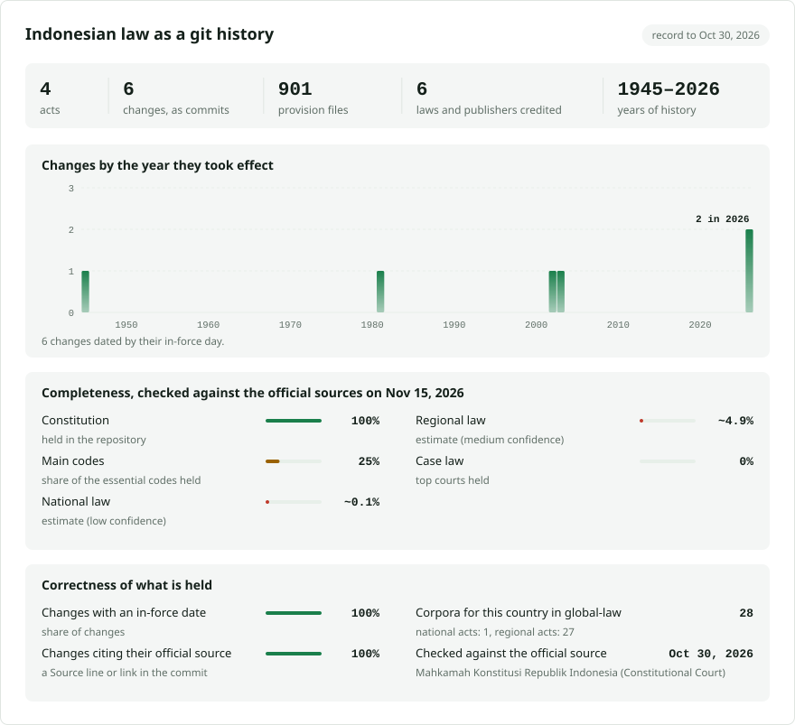

# Indonesia: law history in git

[Bahasa Indonesia](README.md) · **English**

<picture>
<source media="(prefers-color-scheme: dark)" srcset="data/effort-dark.svg">

</picture>

The law of Indonesia as a git history: one file per article (Pasal), one commit per version on the day it took effect, and the law that made each change as the commit's author. `git blame` names the law behind every line; `git log` lists every change to an article; picking a date gives the text in force that day.

Part of [lexifina/global-law](https://github.com/lexifina/global-law), one git history for every country's law: this is Indonesia's national law, which global-law reads at `indonesia/national/acts/`.

**What is in it now:** the Constitution and three statutes, with 6 versions: the Constitution (UUD 1945) as enacted in 1945 and as amended in 1999-2002; the Labour Law (UU 13/2003) and the new Penal Code (UU 1/2023, the KUHP, in force from 2 January 2026), each as enacted; and the 1981 Code of Criminal Procedure (UU 8/1981, the KUHAP), as enacted and as repealed on 2 January 2026 by UU 20/2025. No other statute, regulation or court decision is in it yet. Each act's folder has a `README.md` listing its articles; [`REPRODUCE.md`](REPRODUCE.md) lists the acts and their versions.

Each act is a folder with one file per article: `uu-ketenagakerjaan/pasal-079.md` is Pasal 79 of the Labour Law, on rest and annual leave; the Constitution is in `uud-1945/` (`pasal-028a.md` is Pasal 28A), with its preamble and its transitional and additional provisions as files of their own. `kuhap-1981/` is empty on `main` since the repeal; its text is in the history (`git show kuhap-1981/1981-12-31:kuhap-1981/pasal-001.md`).

The text is in Indonesian, as the official sources print it, their typing slips included. The KUHP was read by OCR (Tesseract) from the signed scan, the only official copy that could be reached: check the scan before relying on its wording. An English translation is not part of this record.

## Questions as git commands

| Question | Command |
| --- | --- |
| Every change to Article 79 of the Labour Law | `git log -p --word-diff -- uu-ketenagakerjaan/pasal-079.md` |
| Which law wrote each line of Article 79? | `git blame uu-ketenagakerjaan/pasal-079.md` |
| Every version of the Labour Law, with the day each took effect | `git log --format="%h %(trailers:key=In-force,valueonly,separator=) %an" -- uu-ketenagakerjaan ':!uu-ketenagakerjaan/README.md'` |
| Article 79 as in force on 1 January 2026 | `python tools/on.py 2026-01-01 uu-ketenagakerjaan 79` |

**Outside git**, we also host this record publicly, for free:

- **[Ask Claude about Indonesian law](https://global-law.lexifina.com/v1/try_claude?country=indonesia)**: opens Claude with a first question ready.
- **[Ask ChatGPT](https://global-law.lexifina.com/v1/try_chatgpt?country=indonesia)**: the same question in ChatGPT.
- **[Search Indonesian law on our site](https://lexifina.com/law?country=indonesia&q=cuti+tahunan)**: a search for "cuti tahunan" (annual leave), with each provision's text and its versions, no account needed.
- **[Developer REST API](https://global-law.lexifina.com/v1/search_law?query=cuti+tahunan&jurisdiction=indonesia)**: the same search as JSON, with no key. See the [documentation here](https://lexifina.com/api/global-law).

Both assistants read the record through the free Global law connector (MCP, `https://global-law.lexifina.com/mcp`); the first time, the chat gives you the link that adds it. Ask in Indonesian or in English.

**Host it yourself easily.** All it takes is git and Python, and the tools run on your machine:

```sh
git clone --depth 1 https://github.com/lexifina/global-law && cd global-law
python3 tools/countries.py add indonesia/national/acts
python3 tools/law.py show 2026-01-01 indonesia/national/acts/uu-ketenagakerjaan/pasal-079.md
```

Opened in Claude Code, Cursor, VS Code or Codex, the clone also starts a local MCP server with the same tools ([MCP.md](https://github.com/lexifina/global-law/blob/main/MCP.md)).

## Dates

Each commit is dated at noon, Asia/Jakarta, on the day the version took effect, and carries it in its `In-force:` trailer:

- for a statute as enacted, the day its own in-force clause gives: the day of promulgation for the Labour Law (Pasal 193) and the 1981 KUHAP (Pasal 286), and 2 January 2026, three years after promulgation, for the KUHP (Pasal 624);
- the four amendments of the Constitution (1999, 2000, 2001 and 2002) are one version, dated 10 August 2002, the day the MPR adopted the last: the source gives only the original text and the final compilation;
- git cannot store dates before 1970, so the Constitution's first version (18 August 1945) is dated 1970-01-01, with the real day in `In-force:`. Ask for a date with `tools/on.py`, not `git log --before`.

Each version is credited to the law that made it (`UU 13/2003`, `UU 20/2025`), at an address that cannot exist. The 2002 version is credited to the four amendments together (`Perubahan UUD 1945 (1999-2002)`), not to each one, and the Constitution's first version to its original text (`UUD 1945`).

## How it is checked

- `tools/check_repo.py` reads every version back from git on the day it took effect and on the day before, and compares it with the corpus the history was built from: 6 versions of 4 acts, no mismatch (see [`REPRODUCE.md`](REPRODUCE.md)).
- `tools/verify_uu.py` checks the Labour Law and the 1981 KUHAP against the text layers of BPK's PDFs, character for character, page headers and headings aside.
- The KUHP's OCR was corrected by hand where checks against the scan found errors (Pasal 3, 82 and 113), and spot checks of scan pages 29, 40 and 200 matched word for word. Other slips may remain, especially in the digits of cross-references.
- A second build from the same corpus gave the same hashes for all 6 history commits and 12 tags. History is append-only: no merge commits, no commit dates going backwards, none in the future, and every commit's trailers parse.

## What it does not show

- **Later amendments and rulings.** The Labour Law is as enacted: the Cipta Kerja amendments (UU 11/2020 and UU 6/2023) and the Constitutional Court's rulings on it are not here, nor its rulings on the 1981 KUHAP (2010-2025).
- **The four amendments of the Constitution one by one.** The Constitutional Court says the single-text compilation used for the 2002 version ("Dalam Satu Naskah") is not an official text; the official texts are the original and the four amendments.
- **The new KUHAP (UU 20/2025).** Only its repeal of the 1981 code is recorded; its official PDF is a scan, and its text is not built.
- **Elucidations (Penjelasan) and chapter headings** are not in the files.
- **Every other statute and regulation**, including the Civil and Commercial Codes (colonial-era texts with no official Indonesian edition found), and the constitutions that applied between 1949 and 1959.

## Sources

| Source | Kind | Past versions | Notes |
| --- | --- | --- | --- |
| [Mahkamah Konstitusi](https://pusdik.mkri.id/materi/materi_294_Buku%20Saku%20UUD%201945%20dan%20UU%20MK_2020.pdf): Buku Saku UUD 1945 dan UU MK (2020) | Official publication of the Constitutional Court | the original text and the text as amended | The Constitution |
| [Peraturan BPK](https://peraturan.bpk.go.id) (JDIH BPK) | Official legislation database | no, each act as enacted | The PDFs of UU 13/2003 and UU 8/1981; the signed scan of UU 1/2023, read by OCR; the record of UU 20/2025, for the repeal |

## Licence

See [`LICENSE`](LICENSE). Statutes are not protected by copyright in Indonesia (UU 28/2014 on Copyright, Pasal 42 letter b); the Constitutional Court's publication of the Constitution states no reuse licence. The history, commit messages, tables and tools are CC0 1.0.

No AI model wrote, translated or corrected legal text; the KUHP's words come from OCR (Tesseract), and the scripts were written by an AI model (see [`REPRODUCE.md`](REPRODUCE.md)).

## More

From [lexifina/global-law](https://github.com/lexifina/global-law):

- [FEATURES.md](https://github.com/lexifina/global-law/blob/main/FEATURES.md): every feature, and what every corpus must support (`git blame`, `law.py`, the MCP tools)
- [FAQ.md](https://github.com/lexifina/global-law/blob/main/FAQ.md): questions and answers · [CONTRIBUTING.md](https://github.com/lexifina/global-law/blob/main/CONTRIBUTING.md): proposing changes · [MCP.md](https://github.com/lexifina/global-law/blob/main/MCP.md): the MCP server · [REPRODUCE.md](https://github.com/lexifina/global-law/blob/main/REPRODUCE.md): how it was built · [CHANGELOG.md](https://github.com/lexifina/global-law/blob/main/CHANGELOG.md)
- [FRESHNESS.md](https://github.com/lexifina/global-law/blob/main/FRESHNESS.md): how current each corpus is · [Monitoring](https://github.com/lexifina/global-law/tree/main/monitoring): whether updates are running · [WATCHING.md](https://github.com/lexifina/global-law/blob/main/WATCHING.md): how each official source is watched for changes
- [performance/](https://github.com/lexifina/global-law/tree/main/performance): how fast the tools are, measured
- [visualisations/](https://github.com/lexifina/global-law/tree/main/visualisations): charts and bridges across the world's law
- [Vulnerabilities](https://github.com/lexifina/global-law/tree/main/vulnerabilities): mistakes in legislation as published
