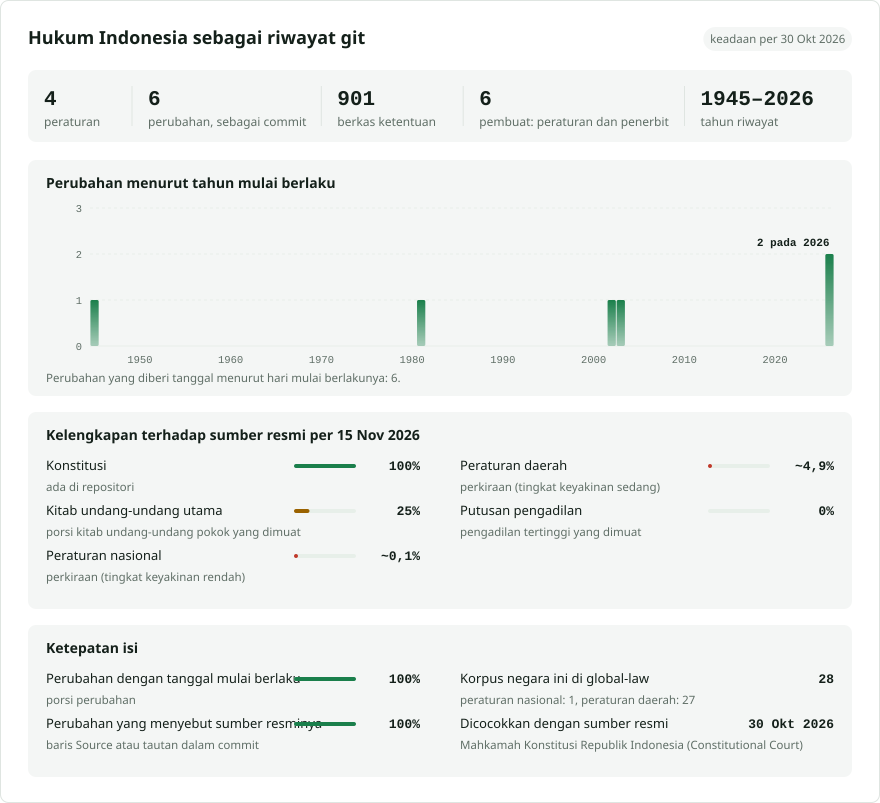

# Indonesia: riwayat hukum dalam git

**Bahasa Indonesia** · [English](README.en.md)

<picture>
<source media="(prefers-color-scheme: dark)" srcset="data/id/effort-dark.svg">

</picture>

Hukum Indonesia dalam bentuk riwayat git: satu berkas untuk setiap pasal, satu commit untuk setiap versi pada hari versi itu mulai berlaku, dan peraturan yang membuat setiap perubahan sebagai penulis (author) commit. `git blame` menunjukkan peraturan di balik setiap baris; `git log` mencantumkan setiap perubahan atas suatu pasal; dengan memilih tanggal, diperoleh teks yang berlaku pada hari itu.

Bagian dari [lexifina/global-law](https://github.com/lexifina/global-law), satu riwayat git untuk hukum semua negara: repositori ini berisi hukum nasional Indonesia, yang dibaca global-law di `indonesia/national/acts/`.

**Isi saat ini:** Undang-Undang Dasar dan tiga undang-undang, dengan 6 versi: UUD 1945 sebagaimana ditetapkan pada tahun 1945 dan sebagaimana diubah pada tahun 1999–2002; Undang-Undang Ketenagakerjaan (UU 13/2003) dan KUHP baru (UU 1/2023, berlaku sejak 2 Januari 2026), masing-masing sebagaimana diundangkan; serta Kitab Undang-Undang Hukum Acara Pidana tahun 1981 (UU 8/1981, KUHAP), sebagaimana diundangkan dan sebagaimana dicabut pada 2 Januari 2026 oleh UU 20/2025. Belum ada undang-undang, peraturan, atau putusan pengadilan lain di dalamnya. Folder setiap peraturan memiliki `README.md` yang mencantumkan pasal-pasalnya; [`REPRODUCE.md`](REPRODUCE.md) mencantumkan peraturan-peraturan itu beserta versinya.

Setiap peraturan adalah satu folder dengan satu berkas untuk setiap pasal: `uu-ketenagakerjaan/pasal-079.md` adalah Pasal 79 Undang-Undang Ketenagakerjaan, tentang istirahat dan cuti tahunan; UUD 1945 ada di `uud-1945/` (`pasal-028a.md` adalah Pasal 28A), dengan Pembukaan serta Aturan Peralihan dan Aturan Tambahannya sebagai berkas tersendiri. `kuhap-1981/` kosong di `main` sejak pencabutannya; teksnya ada dalam riwayat (`git show kuhap-1981/1981-12-31:kuhap-1981/pasal-001.md`).

Teksnya berbahasa Indonesia, sebagaimana dicetak oleh sumber resmi, termasuk salah ketiknya. KUHP dibaca dengan OCR (Tesseract) dari pindaian yang ditandatangani, satu-satunya salinan resmi yang dapat diakses: periksa pindaian itu sebelum mengandalkan kata-katanya. Terjemahan bahasa Inggris tidak termasuk dalam catatan ini.

## Pertanyaan sebagai perintah git

| Pertanyaan | Perintah |
| --- | --- |
| Setiap perubahan atas Pasal 79 Undang-Undang Ketenagakerjaan | `git log -p --word-diff -- uu-ketenagakerjaan/pasal-079.md` |
| Peraturan mana yang menulis setiap baris Pasal 79? | `git blame uu-ketenagakerjaan/pasal-079.md` |
| Setiap versi Undang-Undang Ketenagakerjaan, dengan hari mulai berlakunya masing-masing | `git log --format="%h %(trailers:key=In-force,valueonly,separator=) %an" -- uu-ketenagakerjaan ':!uu-ketenagakerjaan/README.md'` |
| Pasal 79 sebagaimana berlaku pada 1 Januari 2026 | `python tools/on.py 2026-01-01 uu-ketenagakerjaan 79` |

**Di luar git**, kami juga menyediakan catatan ini untuk umum, secara gratis:

- **[Tanyakan kepada Claude tentang hukum Indonesia](https://global-law.lexifina.com/v1/try_claude?country=indonesia)**: membuka Claude dengan pertanyaan pertama yang sudah disiapkan.
- **[Tanyakan kepada ChatGPT](https://global-law.lexifina.com/v1/try_chatgpt?country=indonesia)**: pertanyaan yang sama di ChatGPT.
- **[Cari hukum Indonesia di situs kami](https://lexifina.com/law?country=indonesia&q=cuti+tahunan)**: pencarian "cuti tahunan", dengan teks setiap ketentuan dan versi-versinya, tanpa perlu akun.
- **[REST API untuk pengembang](https://global-law.lexifina.com/v1/search_law?query=cuti+tahunan&jurisdiction=indonesia)**: pencarian yang sama dalam bentuk JSON, tanpa kunci. Lihat [dokumentasinya di sini](https://lexifina.com/api/global-law).

Kedua asisten membaca catatan ini melalui konektor Global law yang gratis (MCP, `https://global-law.lexifina.com/mcp`); pada penggunaan pertama, obrolan memberikan tautan untuk menambahkannya. Bertanyalah dalam bahasa Indonesia atau bahasa Inggris.

**Mudah di-host sendiri.** Yang diperlukan hanya git dan Python, dan alat-alatnya berjalan di komputer Anda:

```sh
git clone --depth 1 https://github.com/lexifina/global-law && cd global-law
python3 tools/countries.py add indonesia/national/acts
python3 tools/law.py show 2026-01-01 indonesia/national/acts/uu-ketenagakerjaan/pasal-079.md
```

Jika dibuka di Claude Code, Cursor, VS Code, atau Codex, klon ini juga menjalankan server MCP lokal dengan alat-alat yang sama ([MCP.md](https://github.com/lexifina/global-law/blob/main/MCP.md)).

## Tanggal

Setiap commit diberi tanggal pukul 12.00 siang, Asia/Jakarta, pada hari versi itu mulai berlaku, dan mencantumkan hari itu dalam trailer `In-force:`:

- untuk undang-undang sebagaimana diundangkan, hari yang ditentukan oleh ketentuan mulai berlakunya sendiri: tanggal diundangkan untuk Undang-Undang Ketenagakerjaan (Pasal 193) dan KUHAP 1981 (Pasal 286), dan 2 Januari 2026, tiga tahun setelah diundangkan, untuk KUHP (Pasal 624);
- keempat perubahan UUD 1945 (1999, 2000, 2001, dan 2002) merupakan satu versi, bertanggal 10 Agustus 2002, hari MPR mengesahkan perubahan terakhir: sumbernya hanya memuat naskah asli dan kompilasi akhir;
- git tidak dapat menyimpan tanggal sebelum tahun 1970, sehingga versi pertama UUD 1945 (18 Agustus 1945) diberi tanggal 1970-01-01, dengan hari yang sebenarnya dalam `In-force:`. Untuk meminta suatu tanggal, gunakan `tools/on.py`, bukan `git log --before`.

Setiap versi dikreditkan kepada peraturan yang membuatnya (`UU 13/2003`, `UU 20/2025`), dengan alamat yang tidak mungkin ada. Versi 2002 dikreditkan kepada keempat perubahan bersama-sama (`Perubahan UUD 1945 (1999-2002)`), bukan kepada masing-masing, dan versi pertama UUD 1945 kepada naskah aslinya (`UUD 1945`).

## Cara pemeriksaan

- `tools/check_repo.py` membaca kembali setiap versi dari git pada hari versi itu mulai berlaku dan pada hari sebelumnya, lalu membandingkannya dengan korpus yang menjadi dasar pembuatan riwayat: 6 versi dari 4 peraturan, tanpa ketidaksesuaian (lihat [`REPRODUCE.md`](REPRODUCE.md)).
- `tools/verify_uu.py` memeriksa Undang-Undang Ketenagakerjaan dan KUHAP 1981 terhadap lapisan teks PDF BPK, karakter demi karakter, tidak termasuk kepala halaman dan judul.
- Hasil OCR KUHP dikoreksi secara manual di tempat pemeriksaan terhadap pindaian menemukan kesalahan (Pasal 3, 82, dan 113), dan pemeriksaan sampel atas halaman pindaian 29, 40, dan 200 cocok kata demi kata. Salah ketik lain mungkin masih ada, terutama pada angka dalam rujukan silang.
- Pembuatan kedua dari korpus yang sama menghasilkan hash yang sama untuk keenam commit riwayat dan 12 tag. Riwayat hanya ditambah: tidak ada merge commit, tidak ada tanggal commit yang mundur, tidak ada yang di masa depan, dan trailer setiap commit dapat diurai.
- [vulnerabilities/](vulnerabilities/): kemungkinan kesalahan perumusan dalam hukum ini, ditemukan oleh detektor global-law dan diperiksa secara manual. Belum dijalankan.

## Yang tidak ditampilkan

- **Perubahan dan putusan selanjutnya.** Undang-Undang Ketenagakerjaan dimuat sebagaimana diundangkan: perubahan oleh Cipta Kerja (UU 11/2020 dan UU 6/2023) dan putusan Mahkamah Konstitusi atasnya tidak ada di sini, demikian pula putusannya atas KUHAP 1981 (2010–2025).
- **Keempat perubahan UUD 1945 satu per satu.** Mahkamah Konstitusi menyatakan bahwa kompilasi satu naskah yang digunakan untuk versi 2002 ("Dalam Satu Naskah") bukan naskah resmi; naskah resminya adalah naskah asli dan keempat perubahan.
- **KUHAP baru (UU 20/2025).** Hanya pencabutannya atas KUHAP 1981 yang dicatat; PDF resminya berupa pindaian, dan teksnya tidak dibuat.
- **Penjelasan dan judul bab** tidak ada dalam berkas.
- **Semua undang-undang dan peraturan lain**, termasuk Kitab Undang-Undang Hukum Perdata dan Kitab Undang-Undang Hukum Dagang (teks zaman kolonial yang belum ditemukan edisi resminya dalam bahasa Indonesia), serta konstitusi yang berlaku antara tahun 1949 dan 1959.

## Sumber

| Sumber | Jenis | Versi terdahulu | Catatan |
| --- | --- | --- | --- |
| [Mahkamah Konstitusi](https://pusdik.mkri.id/materi/materi_294_Buku%20Saku%20UUD%201945%20dan%20UU%20MK_2020.pdf): Buku Saku UUD 1945 dan UU MK (2020) | Publikasi resmi Mahkamah Konstitusi | naskah asli dan naskah setelah perubahan | UUD 1945 |
| [Peraturan BPK](https://peraturan.bpk.go.id) (JDIH BPK) | Basis data peraturan perundang-undangan resmi | tidak, setiap peraturan sebagaimana diundangkan | PDF UU 13/2003 dan UU 8/1981; pindaian UU 1/2023 yang ditandatangani, dibaca dengan OCR; data UU 20/2025, untuk pencabutan |

## Lisensi

Lihat [`LICENSE`](LICENSE). Undang-undang tidak dilindungi hak cipta di Indonesia (UU 28/2014 tentang Hak Cipta, Pasal 42 huruf b); publikasi UUD 1945 oleh Mahkamah Konstitusi tidak mencantumkan lisensi penggunaan ulang. Riwayat, pesan commit, tabel, dan alat berlisensi CC0 1.0.

Tidak ada model AI yang menulis, menerjemahkan, atau mengoreksi teks hukum; kata-kata KUHP berasal dari OCR (Tesseract), dan skripnya ditulis oleh model AI (lihat [`REPRODUCE.md`](REPRODUCE.md)).

Teks ini adalah terjemahan dari versi bahasa Inggris ([README.en.md](README.en.md)); jika terdapat perbedaan, yang berlaku adalah versi bahasa Inggris.

## Visualisasi

- [visualisations/](visualisations/): grafik yang dibuat dari repositori ini. Belum dibuat.

## Informasi lebih lanjut

Dari repositori [lexifina/global-law](https://github.com/lexifina/global-law) (halaman berbahasa Inggris):

- [FEATURES.md](https://github.com/lexifina/global-law/blob/main/FEATURES.md): semua fitur dan apa yang wajib didukung setiap korpus (`git blame`, `law.py`, alat MCP)
- [FAQ.md](https://github.com/lexifina/global-law/blob/main/FAQ.md): tanya jawab · [CONTRIBUTING.md](https://github.com/lexifina/global-law/blob/main/CONTRIBUTING.md): mengusulkan perubahan · [MCP.md](https://github.com/lexifina/global-law/blob/main/MCP.md): server MCP · [REPRODUCE.md](https://github.com/lexifina/global-law/blob/main/REPRODUCE.md): cara pembuatannya · [CHANGELOG.md](https://github.com/lexifina/global-law/blob/main/CHANGELOG.md)
- [FRESHNESS.md](https://github.com/lexifina/global-law/blob/main/FRESHNESS.md): seberapa mutakhir setiap korpus · [Pemantauan](https://github.com/lexifina/global-law/tree/main/monitoring): apakah pembaruan berjalan · [WATCHING.md](https://github.com/lexifina/global-law/blob/main/WATCHING.md): cara setiap sumber resmi dipantau untuk mendeteksi perubahan
- [performance/](https://github.com/lexifina/global-law/tree/main/performance): kecepatan alat, hasil pengukuran
- [visualisations/](https://github.com/lexifina/global-law/tree/main/visualisations): grafik dan keterkaitan lintas hukum seluruh dunia
- [Kerentanan](https://github.com/lexifina/global-law/tree/main/vulnerabilities): kesalahan dalam peraturan sebagaimana diundangkan
